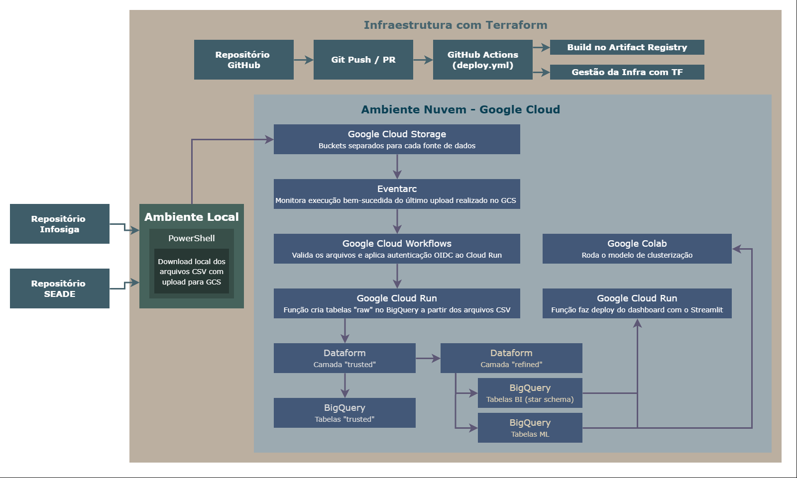

# Projeto Segurança Viária e Mortalidade - Mackenzie Hands On
Este repositório contém uma solução completa de **Engenharia de Dados, Modelagem Analítica e Machine Learning (K-Means)** para análise de acidentes de trânsito e indicadores socioeconômicos (IPDM) no **Estado de São Paulo**, utilizando dados públicos do **InfoSiga SP** e da **SEADE**.

A arquitetura é totalmente serverless e nativa da **Google Cloud Platform (GCP)**, integrando ingestão automatizada via eventos, orquestração com Workflows, transformação com **Dataform**, infraestrutura como código com **Terraform** e entrega de valor por meio de um aplicativo web interativo em **Streamlit** executado no **Cloud Run**.

---

## 🏗️ Arquitetura Geral do Sistema (E2E)

##🛠️ Tecnologias e Ferramentas Utilizadas
**Cloud & Serverless**: Google Cloud Platform (GCP), Cloud Run, Cloud Storage, Artifact Registry, Eventarc, Cloud Workflows.

**Engenharia de Dados**: BigQuery, Dataform (SQLX), Python (Pandas).

**Infraestrutura como Código (IaC)**: Terraform, GitHub Actions (CI/CD).

**Data Science & Visualização**: Scikit-Learn (K-Means), Streamlit, Plotly, Jupyter Notebooks.

##📂 Estrutura de Diretórios e Descrição dos Arquivos

Abaixo está o detalhamento de cada pasta e arquivo presente no repositório:

├── .github/
│   └── workflows/
│       └── deploy.yml                        # Pipeline de CI/CD (GitHub Actions para Build de Containers e Terraform Apply)
├── cloudrun_services/
│   ├── dashboard/
│   │   ├── Dockerfile                        # Configuração de container para o aplicativo Streamlit
│   │   ├── main.py                           # Código-fonte principal do Dashboard (Streamlit, Pandas, Plotly, K-Means)
│   │   └── requirements.txt                  # Dependências Python do dashboard (streamlit, plotly, scikit-learn, etc.)
│   └── raw_data_create/
│       ├── Dockerfile                        # Container para o serviço de carga de dados brutos
│       ├── main.py                           # Script Python de ingestão/carga para o BigQuery
│       └── requirements.txt                  # Dependências do serviço de ingestão (google-cloud-bigquery, db-dtypes)
├── definitions/
│   ├── refined/
│   │   ├── refined_ml_features.sqlx          # Tabela refinada contendo as features normalizadas para o modelo de Machine Learning
│   │   └── star_schema.sqlx                  # Modelagem dimensional final (Fatos e Dimensões em Star Schema)
│   └── trusted/
│       ├── trusted_accidents.sqlx            # Transformação e limpeza da camada Trusted para acidentes
│       ├── trusted_people.sqlx               # Limpeza e padronização dos dados de vítimas/envolvidos
│       ├── trusted_seade_idpm.sqlx           # Integração dos índices de desenvolvimento municipal (IPDM SEADE)
│       ├── trusted_seade_mortality.sqlx      # Tratamento de mortalidade e estatísticas vitais da SEADE
│       └── trusted_vehicles.sqlx             # Limpeza e categorização de veículos envolvidos nos sinistros
├── documentacoes/
│   ├── arquitetura_e2e.png                   # Diagrama visual da arquitetura end-to-end do projeto
│   └── catalogo_de_dados_trusted.md          # Dicionário e catálogo de dados documentando as tabelas Trusted
├── download_files/
│   └── file_download_exec.ps1                # Script PowerShell utilitário para automação de downloads e organização de arquivos locais
├── eda/
│   ├── EDA - raw_accidents.ipynb             # Análise Exploratória de Dados (EDA) focada na base de acidentes brutos
│   ├── EDA - raw_vehicles.ipynb              # Análise Exploratória de Dados focada na frota e veículos envolvidos
│   └── EDA_raw_people.ipynb                  # EDA explorando perfis de vítimas e envolvidos
├── machine learning/
│   └── modelo_cluster.ipynb                  # Notebook de prototipagem e validação do algoritmo K-Means (5 clusters de risco)
├── terraform/
│   ├── main.tf                               # Infraestrutura como Código principal (Cloud Run, IAM, Artifact Registry)
│   ├── variables.tf                          # Definição de variáveis de entrada do Terraform (project_id, region, imagens)
│   └── workflows.tf                          # Recursos Terraform para Cloud Workflows, Eventarc e Service Accounts
├── workflow_settings.yaml                    # Configurações globais de integração para o Dataform
└── README.md                                 # Documentação oficial do projeto

##🚀 Como Executar o Projeto Localmente

**1. Executar o Dashboard Streamlit**
Certifique-se de ter o Python 3.10+ instalado. Navegue até a pasta do dashboard e instale as dependências:

`cd cloudrun_services/dashboard
pip install -r requirements.txt`

Certifique-se de que os arquivos de dados consolidados ou as exportações necessárias estejam na raiz ou configure os caminhos, em seguida execute:

`streamlit run main.py`

**2. Provisionar a Infraestrutura com Terraform**
Para aplicar a infraestrutura na GCP via Terraform:

`cd terraform
terraform init
terraform plan -var="project_id=SEU_PROJECT_ID" -var="region=us-central1"
terraform apply`

##📄 Licença
Desenvolvido para fins educacionais e aplicados de engenharia de dados e segurança viária.

